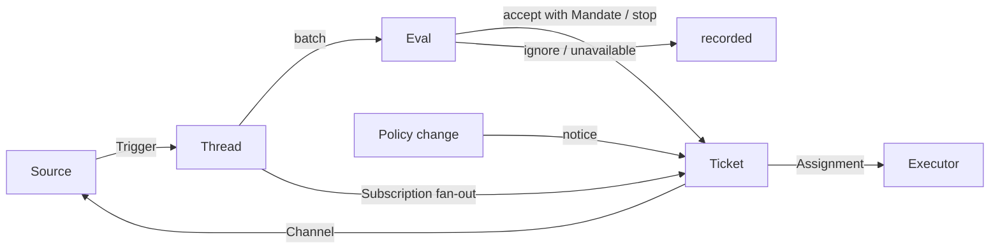

# 001 领域模型

本文档命名 dsh-superagent 的概念，以及每个概念所维护的规则。代码、智能体调用的工具、面板以及其他文档都使用这些术语，且不使用其他术语。遵循 [000 哲学](000-philosophy.md)，模型只保留工作所需的概念，一项业务需求会成为其中某个概念的属性。

## 流程

工作从触发（Trigger）经过评估（Eval）到达执行。来源（Source）产生触发。触发作为上下文扇出到订阅了其线程（Thread）的工单（Ticket）。一个人发来、并以这种方式到达某工单的消息会留在该工单；其他每个触发都进入评估，由评估决定它是否请求新的工作。当评估接单时，它会带着授权（Mandate）创建一个工单。派工（Assignment）把工单交给执行器（Executor），结果通过渠道（Channel）回到来源。

## 概念

来源、线程、评估、授权和订阅构成核心领域；其余概念为它们提供支撑。

| 概念 | 定义 | 它维护的规则 | 它为何存在 |
| --- | --- | --- | --- |
| 来源 Source | 一串事件流。来源种类（kind）是一个可复用的实现；来源实例（instance）是某一种类的一份配置：它是否运行、监听什么 | 持有自己的读取位置和自己的机器人身份。定义什么算作一个事件，包括只在时间维度上成立的条件。在机器人自己的消息以及它监听范围之外的触发进入领域之前将其丢弃。把每个触发翻译成它所属的线程，以及用于回复的渠道地址 | 重启不得重放事件 |
| 触发 Trigger | 一个不可变事件，带有来源自己的元数据，例如它的参与者（actor） | 属于一个或多个线程。同一个触发被接单两次只会创建一个工单 | 审计和幂等的单位 |
| 线程 Thread | 按时间顺序排列的触发；来源定义哪些触发组成一个线程 | 同一时间最多有一个评估在它上面运行。它可能有多个工单。它持有自己的订阅、正在运行的评估以及它的决定历史 | 给评估一个一致的视图和它的上下文 |
| 关联 Correlation | 一个触发所属的多个线程之间的关系 | 只补充上下文；从不路由 | 让评估能顺着相关证据追溯 |
| 渠道 Channel | 线程的写侧；来源定义它的地址 | 一个线程可能有多个渠道；一个工单持有一组渠道 | 确认、回复、拉取请求和已解决的评审都是写入 |
| 策略 Policy | 版本化的评估规则以及每个来源的部分：谁能通过该来源发起工作，以该来源自己的身份，名单如何同步，以及哪些机器人可以成为候选 | 策略版本覆盖规则、接单模式和来源部分。影响某个活跃工单的变更，例如它所依据的规则发生变更，会投递给它的派工；它不会撤销授权。不同来源上的身份从不互相映射 | 当规则变化时，正在运行的评估必须被丢弃 |
| 评估 Eval | 对一批触发的判断，分两层：准入（gate）和研判（assessment） | 输入：触发批次、线程快照、该线程上的每个工单（包括已结束的），以及当前策略。输出：一个决定（Decision）。不持有状态 | 决定新工作是开始、继续还是停止 |
| 授权 Mandate | 一次接单所授予的内容：策略版本、范围、强度、匹配的规则、发送者在该来源上的身份，以及来源如何收到该触发 | 不可变；范围更宽意味着新工单。工单的结束不会终结它：只有人的停止会撤销它，而不再支持它的策略会撤销它。在已结束的工单恢复之前，会针对当前策略重新校验 | 说明这项工作为什么可以做，以及可以做到什么程度 |
| 工单 Ticket | 一个被授权的工作单元 | 只有评估能创建它。引用它的授权；持有它的渠道和输入（Input）。从 open（打开）→ ended（结束），当一个人在其线程之一上发消息使其恢复时回到 open，除非有人停止了它。定义自己的状态，而不是跟随执行器的状态 | 拥有执行及其报告 |
| 派工 Assignment | 工单与一个执行器实例的绑定 | 一个工单随时间可能有多个派工。独立于工单地从 pending（待启动）→ running（执行中）→ ended（已结束）。只有它的最终报告才能在执行器一侧结束工单 | 执行器在领域之外，但谁在执行必须在领域之内 |
| 订阅 Subscription | 工单与线程之间的多对多关系，由线程持有 | 匹配的触发扇出到每个活跃的已订阅工单，不检查发送者是谁；一个人发来、并以这种方式到达工单的消息不经过评估。执行器仅为上下文而关注的线程，也以同样方式到达其工单，但不赋予它任何权威，也不会使其恢复。已结束的工单保留其订阅，包括一个已关闭或已合并的拉取请求的订阅：一个人的消息会在同一授权下使其恢复，无需评估或决定；来自机器人和 CI 的消息不会到达它，因为它的执行器在恢复时会重新读取其线程。被一个人停止的工单不接收任何消息。主 Session 只有当消息明确指向某个现有工单时，才会把线程附加到该工单。一个人可以丢弃线程上的所有订阅；执行器只能丢弃自己的工单对某个它认为无关的线程的订阅，但其工单起始的线程、以及来源让它关注的线程（例如它的拉取请求的线程）除外 | 后续讨论能在无人再次提及智能体的情况下到达执行器 |

人不是一个领域概念。触发携带其参与者的标识符，由来源给出。允许名单是策略中来源的部分，以该来源的身份表示。同一个人在多个来源上都有账号，这是智能体在需要时阅读的提示词文本。

执行器连同它的 Session 和目录，在领域之外，通过派工连接。

聚合（aggregate）：来源持有它的读取位置。线程持有它的订阅、正在运行的评估（串行运行，并把期间到达的触发合并进下一批）以及它的决定历史。工单持有它的派工、渠道和输入，并通过 id 引用决定。

## 被拒绝的概念

| 被拒绝的概念 | 原因 |
| --- | --- |
| 将 Principal 或 Membership 作为实体，或跨来源映射身份 | 人是触发的元数据；允许名单是策略中来源的部分；跨来源映射是提示词文本 |
| 评估调度自己的延迟触发 | 需要等待的条件就是一个普通的来源，因此评估永远不会反过来依赖来源 |
| 等待中或已撤销的评估状态 | 等待属于来源；运行超时的评估会重新排队其触发，或者以 `unavailable`（未完成）结束 |
| 每个线程最多一个活跃工单 | 一个线程可以承载多件独立的工作；研判从工单列表中避免重复 |
| “追加到工单”的决定 | 追加就是订阅扇出，无需评估 |
| 对订阅做准入检查 | 订阅覆盖整个线程；授权把授权与上下文分开 |
| 会路由的关联 | 订阅负责路由；关联只补充上下文 |
| 跟随 DSH Session 的工单状态 | 工单可以被移交、恢复，或由多个执行器运行，因此它定义自己的状态 |
| 执行器声明某人要求它停止 | 只有评估决定一次结束的强度 |
| 在策略变化时取消运行中的工单 | 被取消的变更会留下半成品；变更是被记录并投递，而不是取消 |
| 当执行器 Session 失败或受阻时锁住它的所有工具 | 这会拒绝直接在 Session 里工作的人，以及恢复后的报告；暂停自动输入就足够了 |
| 从报告的自由文本推断“在等人” | 该分类需要结构化事实；执行器通过结构化字段提问 |

## 什么可复用

上面的概念及其规则是可复用的。来源实现、策略内容、执行器和渠道实现属于某个部署。每个来源在内部保留自己的用语，例如消息（message）、聊天（chat）或通知（notification），并把它们翻译成触发。

| 部分 | 在本仓库中 |
| --- | --- |
| 来源 | 飞书：实时事件、历史恢复、订阅话题的轮询。GitHub：通知、订阅的 Issue 和拉取请求、CI 变更、已合并或关闭的拉取请求，以及在开启时，仓库中的每个新 Issue、拉取请求和评论，以及默认分支的 CI |
| 策略 | 评估规则，以及每个来源的允许名单、它的同步、它的机器人名单和它的准入表 |
| 执行器 | 每个工单一个 DSH 执行器 Session 和一个目录，运行在执行器与来源共同注册变量的执行环境中 |
| 渠道 | 飞书话题回复、GitHub 评论和评审线程回复 |

## 术语表

本文档及后续文档所用术语的参考列表，附其中文名；后续文档会解释上文未介绍的术语。面板一次只显示一种语言；它的（?）按钮会打开这份双语的术语表。智能体在 GitHub 和飞书上发给人的消息使用通俗语言，而不是这些术语。

| 术语 | 中文 | 含义 |
| --- | --- | --- |
| Agent | 智能体 | dsh-superagent 运行的自动化团队成员，通过诸如 GitHub 账号和飞书机器人等身份在来源上行动 |
| Main Session | 主 Session | 评估触发、接单并分派工单、以及回复的 DSH Session；在代码和提示词中为 `orchestrator` |
| Executor Session | 执行器 Session | 执行器为一个工单运行的 DSH Session；在代码和提示词中为 `worker` |
| Source | 来源 | 一串事件流：插件提供的一个种类，加上一份实例配置 |
| Trigger | 触发 | 来自来源的一个不可变事件 |
| Thread | 线程 | 按时间顺序排列的触发；评估在其中一次只运行一个的单元 |
| Correlation | 关联 | 共享一个触发的线程之间的关系；它只补充上下文 |
| Channel | 渠道 | 线程的写侧 |
| Policy | 策略 | 接单工作的版本化规则，以及每个来源的部分，例如谁可以在那里请求工作 |
| Policy version | 策略版本 | 规则、来源部分和接单模式的某种组合的标识符；每个授权都会记录它 |
| Eval | 评估 | 把一批触发变成一个决定的过程 |
| Gate | 准入 | 评估的确定性第一层：谁可以发起工作，以及以什么强度 |
| Assessment | 研判 | 评估过程中模型的判断 |
| Decision | 决定 | 评估的结果 |
| Mandate | 授权 | 一次接单所授予的内容：强度、范围，以及它所依据的策略版本 |
| Ticket | 工单 | 一个被授权的工作单元 |
| Assignment | 派工 | 工单与一个执行器实例的绑定 |
| Subscription | 订阅 | 工单与线程之间的关系 |
| Fan-out | 扇出 | 把订阅线程的触发作为上下文投递给工单 |
| Executor | 执行器 | 运行派工的端口：每个工单一个执行器 Session 和一个目录 |
| Execution environment | 执行环境 | 执行器 Session 和 prepare 命令运行的地方：执行器和来源注册的变量，每个都有键、值和描述 |
| Report | 报告 | 派工向其工单报告的状态 |
| Attention | 待人工决定 | 工单上等待人来回答的问题 |
| Disposition | 去向 | 一个触发被过滤、评估或扇出的记录 |
| Input | 输入 | 投递给工单的上下文：扇出的触发、策略变更、恢复和文本 |
| Scope | 范围 | 授权所允许的工作 |
| Strength | 强度 | 授权或评估的依据有多强 |

| 分组 | 取值 |
| --- | --- |
| 决定 Decision | accept 接单 · stop 停止 · ignore 忽略 · unavailable 未完成 |
| 强度 Strength | explicit 明确 · inferred 推断 |
| 派工 Assignment | pending 待启动 · running 执行中 · ended 已结束 |
| 报告 Report | progress 进展 · waiting 等待 · ready 就绪 · blocked 受阻 · failed 失败 · dropped 无需处理 |
