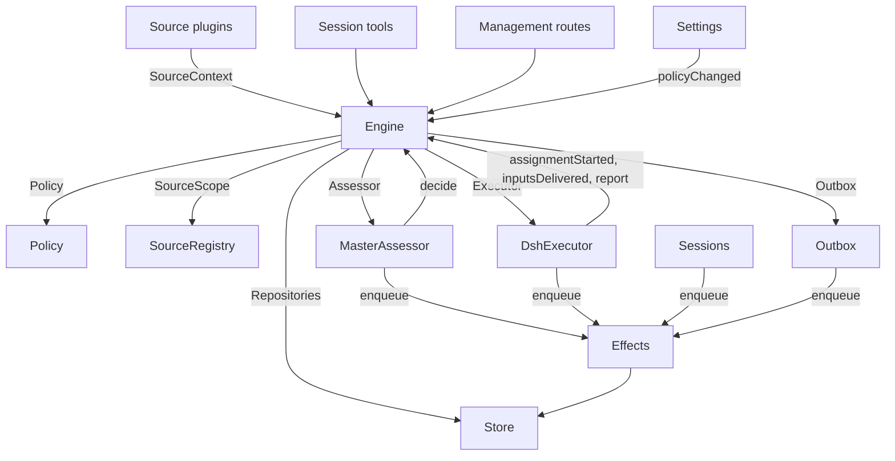

# 007 架构

这是实现的开发者指南。它把 [001 领域模型](001-domain.md) 到 [006 部署](006-deployment.md) 中的概念映射到类、接口和文件。先看运行时（Runtime）和 Engine，然后把模块表和测试表当作代码索引。

## 核心类和粘合层

核心类在小接口后面拥有领域概念和外部边界。粘合层把工具参数、HTTP 请求、来源载荷和 DeepSeek Harness 事件翻译成对这些类的调用，然后把结果变成卡片、视图和消息。

`Runtime`（`src/app/runtime.ts`）构造应用、提供依赖，并拥有启动和关停。`Engine` 构造自己的内部部分。执行器和研判器回调进 Engine，所以 Runtime 给它们 getter，而不是要求以循环顺序构造。

### Runtime

`Runtime` 是组合根；它不含领域规则。它的构造函数锁住状态目录，打开 Store，并构建每个组件。如果构造失败，它关闭 Store 并释放锁。

启动注册管理路由并运行 Setup。设置解决后，它安装 Session 和执行器钩子，确保主 Session 存在，启动策略同步，恢复被中断的派工，并启动 passes 和 effects。`ready` 标记启动完成。

关停取消回合，等待 passes、effects 和智能体，恢复进程环境，关闭 Store 并释放锁。来源插件通过窄接口 `SourceHost` 把 Runtime 注入为 `orchestrator` 服务。

| 部分 | 模块 | 做什么 |
| --- | --- | --- |
| Setup | `src/app/setup.ts` | 通过按 worker shell 运行方式探测它们的 CLI 来解析仓库和账号，写入并应用 worker 的环境和命令 shim，并保留设置问题；Settings 通过它检查变更的账号，并通过它重启（这会再次运行设置） |
| Passes | `src/app/passes.ts` | 一次一个 pass，每两秒一次，以及每当有命令要求时：先处理到期的 effects，然后 `Engine.evaluateDue`；来源的触发通过它到达 Engine |
| Outbox | `src/app/outbox.ts` | Engine 的 `Outbox` 端口，也是回执的唯一写入者：`send` 在一个事务中保留消息的回执并排队它的 `reply` effect，该 effect 的处理函数通过 `SourceRegistry.send` 发送它；消息在其来源关闭时等待，在会话消失或不被监听时被丢弃 |
| Notices | `src/app/notices.ts` | 把领域事件和 worker 活动转成主 Session 消息。`eventNotice` 处理领域通知；`reportRelay` 立即转发问题、把普通进展保留在其工单上、并中继其他报告；`followupRelay` 指出拥有人类后续的工单。回合期间到达的中继，在它的下一步一起通过 DeepSeek Harness inbox 投递 |

### Engine

`Engine`（`src/core/engine.ts`）是触发、线程、决定、工单和派工的唯一写入者。它从 `src/core/ports.ts` 接收这些端口：`Repositories`、当前策略 getter、`SourceScope`、`Assessor`、`Executor` 和 `Outbox`。可选依赖是 `prepareTicket`、`now` 和 `emit`。

所有 Engine 方法都是同步的。每个命令在一个事务中更改它的聚合。`evaluateDue` 对每个它更改的 Eval 或 Ticket 使用单独事务。端口在事务内排队外部工作；适配器在提交后执行它。无效请求抛 `UserError`。

Engine 暴露一个入口点并委托给五个内部部分。它拥有每个命令的事务。跨部分的命令，例如 `attach`、`evaluateDue` 和 `policyChanged`，按顺序调用这些部分。

每个部分扩展 `EnginePart`（`src/core/part.ts`），它提供选项和共享读取。部分之间的依赖单向流动：

| 部分 | 职责 | 依赖 |
| --- | --- | --- |
| `Intake` | 来源的触发：连同其去向存储一次，记录在其线程及其关联上，扇出到已订阅工单，并且除非它是一条到达了某工单的人的消息，否则在其主线程上排队等待评估 | Tickets |
| `Evals` | 线程的评估：批处理，准入的强度、参与者和依据及给出它们的触发（`primary`），从候选投递起的截止时间及其随暂停的推移，过期评估的重新排队，候选、重放和交回，策略变更时的重新排队，以及每个评估最终的决定：accept、stop、ignore 或 unavailable | Tickets |
| `Tickets` | 工单生命周期：从带其授权、订阅和首次派工的接单创建，它跟随的线程及其关闭（`followsDone`），附加的线程和为上下文关注的线程，输入和注释，恢复以及恢复拒绝的消息，重试、重启、停止和结束，它丢弃的订阅，以及策略变更对它影响到的工单的通知 | Replies |
| `Assignments` | 执行器及其 worker 报告的内容：派工已开始，输入到达或未能到达，重启中断了它，以及 worker 的报告及它给人的问题 | Tickets, Replies |
| `Replies` | 通过 `Outbox` 的渠道写入：确认、回答、结果和关注消息，各按允许它的规则 | 无 |

命令使用祈使式名称，例如 `stopTicket`；适配器报告的事实使用过去式名称，例如 `assignmentStarted`。查询 `candidate` 使用名词。

调用者只收到其角色的 Engine 的 `Pick`：`EngineForSources`、`EngineForMainSession`、`EngineForPeople`、`EngineForSettings` 或 `EngineForExecutor`。

| 角色 | 方法 | 效果 |
| --- | --- | --- |
| Sources | `receive(trigger)` | 存储触发一次并回答 `stored`、`duplicate`，或当没有来源接收它时回答 `filtered`；把它扇出到订阅其线程的工单，那里一个人的消息会立即恢复已结束的工单（除非处理暂停），并在其主线程上排队等待评估，除非它是到达了某工单的人的消息，那它留在该工单 |
| Sources | `bindThread(ticketId, thread, own)` | 让一个打开的工单跟随来源的某个线程（例如拉取请求的），当工单打开它时为 `own`；再次绑定的已关闭线程会再次打开。是线程的关闭（而非 `ready` 报告）结束工单 |
| Sources | `threadClosed(thread, outcome, at)` | 线程已关闭：跟随它的每个打开工单记录该关闭，并在完成它所跟随的线程后结束（`followsDone`）：它打开的线程没有打开的，或当它一个都没打开时，它跟随的每个线程都已关闭。它以这些关闭中最新者的结果 `merged` 或 `closed` 结束，除非关闭后恢复的工作尚未报告 `ready`，或其执行器通过确认或回答接收了它在其最新非 `progress` 报告之后、或其最后回合结束之后决定的人类后续；`dropped` 报告随后以关闭的结果结束它 |
| Main Session | `candidate(triggerId)` | 持有某触发的评估，如其研判器所见 |
| Main Session | `candidateDelivered(evalId)` | 评估的候选到达主 Session：其截止时间从现在起算 |
| Main Session | `decide(triggerId, outcome)` | 记录评估决定，或对明确请求的直接决定。接单原子地创建工单、授权、派工、订阅和确认。从卡片忽略的推断候选在提供的理由之前记录 `ignoredFromCard`。当 `followupOwners` 仍拥有人类后续时，只允许停止 |
| Main Session | `attach(ticketId, triggerId, note?)` | 把触发路由到它指向的工单，该工单的执行器随后把它作为后续决定，并结束持有它的评估，该评估的其他触发等待新的评估；已结束工单立即在其授权下恢复（除非处理暂停）。执行器仍在决定的后续被拒绝，路由回交回它的工单的后续也被拒绝 |
| Main Session | `requestStatus(ticketId)` | 向等待的执行器 Session 询问其状态，并回答它是否询问了 |
| Main Session | `note(ticketId, text)` | 把其他工作的事实作为文本输入给工单的执行器，这不授予任何东西 |
| Main Session, Executor | `reply(request)` | 为其目的所指的渠道排队消息：`acknowledgement`、`answer`、`result` 或 `attention` |
| People | `stopTicket(ticketId, reason?)` | 一个人的停止，撤销授权 |
| People | `retryTicket(ticketId)` | 结束一个在 `failed` 或 `blocked` 报告后等人、或其输入投递失败（`canRetry`）的工单的停滞派工，并启动新派工 |
| People | `reevaluate(triggerId)` | 把已存储的触发排队以进行新的评估 |
| People | `unsubscribe(thread)` | 丢弃线程上的所有订阅，跟随它的工单不再跟随它；每个工单继续决定它在那里收到的后续 |
| People | `dismiss(decisionId)` | 驳回一个 `unavailable` 决定所展示的问题，由该决定记录 |
| Executor | `assignmentStarted(ticketId, assignmentId)` | 派工运行；其等待的输入发出 |
| Executor | `inputsDelivered(ticketId, assignmentId, inputIds)` | 输入到达派工的执行器 Session，在那里每个等待一个步骤来接收它 |
| Executor | `inputsRead(ticketId, inputIds)` | 执行器 Session 把承载这些输入的消息纳入其历史（一个 `user/message` Session 事件），其模型从中获得它们；一个认领了它们、在此之前被取消或失败的步骤不算。每个在报告或回合结束随之而来时计为已读，重启后也如此，其工单的结束不会放开它；在读取记录之前投递的输入，在报告或回合结束随其投递而来后计为已读 |
| Executor | `turnEnded(ticketId, assignmentId)` | 执行器 Session 的一个回合结束了，报告后也如此，一旦没有东西在后台为它运行、或它向人交接时。步骤之前接收的，它已读（`inputsRead`） |
| Executor | `deliveryFailed(ticketId, assignmentId, error)` | 投递输入失败；工单显示它，直到一次投递成功、新派工开始或工单结束 |
| Executor | `report(ticketId, report)` | 记录报告及其给人的问题；`dropped` 结束工单，`ready` 完成一个不跟随线程的工单，并结束一个完成其跟随线程的工单（如它们结束那样） |
| Executor | `markUnrelated(ticketId, thread, reason)` | 只丢弃该工单对某个它发现无关的附加线程的订阅，并连同理由交回该工单在那里决定的后续 |
| Executor | `followForContext(ticketId, thread)` | 为上下文把打开的工单订阅到相关线程：其消息到达工单，但不给它后续强度，也不恢复它 |
| Executor | `handback(ticketId, triggerId, reason)` | 记录工单交回到达它的触发，连同其候选所携带的理由，一旦没有其他工单决定它、且如果这个工单曾决定它，就把它排队以进行新的评估；它回答是否排队了它。工单每个触发交回一次，并保留其订阅 |
| Executor | `assignmentInterrupted(ticketId, assignmentId)` | 宿主停止时派工正在运行：一个工作中被中断的，或一个在其最新报告后收到输入的，带恢复说明和投递给它、但其执行器 Session 未接收的输入重新开始，如重试那样；一个自那时起已报告的保留其 Session。DshExecutor 在每个开始时报告它们（`resume`），最旧工单优先，并再次排队等待中的启动 |
| Passes | `evaluateDue()` | 除非处理暂停：启动其排队触发在等待的线程的评估，每线程一个，并把期间排队的触发作为一批；把超过截止时间的评估的触发再次排队，连续两次，第三次记录为 `unavailable`；并恢复暂停期间人的消息所到达的已结束工单，如果它们的授权仍成立。候选尚未到达主 Session 的评估不过期。处理暂停时，没有评估过期，一旦恢复，每个截止时间随暂停时长向后移动 |
| Settings | `policyChanged(from, to, effects)` | 告诉每个受影响活跃工单变更如何影响它（`src/policy.ts` 中的 `policyEffects`：它被接单所依据的规则变了或不再适用，其请求者可能不再能发起工作，或主动工作不再被接单），并在新版本下重启进行中的评估 |

Engine 把批处理、授权、扇出、恢复和关注生命周期规则保持为私有。几个共享谓词使这些规则一致：

- `waitsForPerson`（`src/core/model.ts`）：最新派工报告了 `blocked` 或 `failed`，且此后没有人类消息到达。为真时，自动输入和失败的启动保持挂起。
- `followupOwners`：仍对自己线程上收到的人类后续负责的工单。工单可以活跃，或已结束但无人的停止且等待恢复。交回消息结束该所有权。
- `settled`：决定解决了请求；stop、unavailable、routed 和 refused-stop 决定不算。
- `ticketStage`（`src/core/stage.ts`）：实现 [003 执行](003-execution.md) 中的阶段表。

当工单结束时，未读后续返回评估，除非另一工单仍拥有它们或另一去向解决了它们。已确认、已回答和已交回的消息被排除。对没有确认去向的较旧记录，outbox 回执提供该事实。最终报告也覆盖派工开始时等待的消息，包括恢复它的那条消息。停止工单的消息不会自动重新评估。

变更后，Engine 从 `src/core/ports.ts` 的 `DomainEvents` 发出一个事件：

`trigger.received`、`eval.started`、`decision.recorded`、`ticket.created`、`ticket.resumed`、`ticket.ended`、`assignment.started`、`assignment.ended`、`thread.subscribed`、`thread.unsubscribed`、`trigger.requeued` 或 `policy.changed`。

Runtime 把 `ticket.ended`、`trigger.requeued` 和 `thread.unsubscribed` 变成通知。投递给工单的人类 `trigger.received` 变成后续中继。`pullEndNotices` 在工单以 merged 或 closed 结束时用稳定 id 发一条聊天通知。其他事件目前没有消费者。

### Model

`src/core/model.ts` 持有领域类型，`src/core/stage.ts` 持有工单阶段。决定把为什么记录为 `reason`，一个 `Reason` 列表（`src/core/reasons.ts`）：每个一个 `code` 及其 `values`，以及对批次中的某个触发，其 `triggerId`。

核心的代码，例如 `timeout`、`policyChanged`、`routed` 和 `startedTicket`，是 `REASONS`，带有智能体通过 `reasonText` 阅读的英文；准入或来源范围给出自己的，例如 `not_a_member`；`said` 携带研判器或某人所写的话语。面板用 `reason.<code>` 为每个代码措辞，来源过滤的触发也以同样方式记录来源的代码。

工单每个事实只保留一次。它没有 `ended` 时是打开的，`ended` 记录它何时、由谁、为什么以及以什么结果结束；它最后所说的是其最新派工报告（`latestReport`）；其执行器 Session 以它命名（`src/executor/dsh.ts` 中的 `workerSessionId`）。

它的字段是类型化的：`origin`，给出其评估批次强度及批次本身（`triggerId`、`triggerIds`）的可准入触发；`execution`，执行器选择的内容（`name`、`directory` 和 `assignment`）；`delivery`，最后一次失败的输入投递（`error`、`at`），直到投递成功、新派工开始或工单结束；以及 `follows`，来源让它跟随的线程，每个 `{thread, own, closed?}`：当工单打开它时为 `own`，一旦关闭则 `closed` 带 `at` 和 `outcome`。只有 Tickets 写 `follows`；GitHub 来源用 `pullsOf` 和 `pullOf` 读取其拉取请求（`src/sources/github-pull.ts`）。

承载触发的输入记录它是否由人所写，`waitsForPerson` 读它。线程也在 `context` 中列出只为上下文跟随它的已订阅工单，并在 `expired` 中计数其排队触发中连续过期的评估；评估记录其 `primary` 触发及候选何时被 `delivered`。

触发的去向记录它到达的工单（通过扇出或附加）、人的重新排队、每个交回它的工单（带理由），以及每个其执行器确认或回答了它的工单。

授权的 `basis`（`MandateBasis`）记录准入如何接纳其触发。重新校验读取接收的 `source`、`scope` 和 `row`，名单上的 `sender`，匹配的 `rules`，以及 `via`：

| `via` | 准入依据 |
| --- | --- |
| `addressed` | 允许的发送者针对了智能体 |
| `followup` | 消息到达带工单的线程 |
| `admission` | 准入表某格；`observation` 标记推断候选 |
| `bot` | 名单上的机器人产生推断候选 |

触发和线程的 `meta` 属于来源。核心不解释它们。

### Policy

`src/policy.ts` 定义设置 schema、授权和评估规则。`settingsPolicy(settings, scope)` 每次使用返回一个全新的、无状态的 `Policy`：

- `version`、`paused` 和 `evalTimeoutMs` 描述其当前状态。
- `gate(trigger, thread, tickets)` 返回准入强度和依据。
- `revalidate(mandate)` 检查现有授权是否仍成立。
- `admitsInferred(rules)` 只允许在 auto 模式且启用匹配规则时的主动接单。

`assessmentOutcome(assessment, settings, strength)` 把模型的研判转成 Engine 结果。它要求每条启用规则都有判断、已解决的方向、匹配规则和意图证据。在 auto 模式之外，推断接单变成“would accept（会接单）”记录。

`policyEffects(tickets, old, now, scope)` 识别变更影响哪些打开工单以及如何影响。`Engine.policyChanged` 只通知那些工单。`policyVersion` 对规则、接单模式和来源的策略部分（包括机器人名单）取哈希。

### Store

`Store`（`src/app/store.ts`）拥有一个 SQLite 数据库。Runtime 在打开它之前获取目录锁，防止第二个进程迁移或写同一状态。

它的接口按目的分组：

- **领域仓库：** `atomic`，加上 `triggers`、`threads`、`tickets` 和 `decisions`，各有 `get`、`save` 和列表查询。索引的工作集是 `threads.active()`、`tickets.open()`、`tickets.active()` 和 `read.subscribedThreads`。
- **读取查询：** `read` 通过诸如 `threadTriggers`、`triggerStats`、`search` 和 `droppedReplies` 之类的方法服务视图、工具和来源轮询。这些方法绝不写。
- **来源元数据：** `threads.describe` 和 `threads.patchMeta` 更新来源拥有的线程元数据。
- **设置：** `settings`、`saveSettings`、`blockRevision` 和 `settingsHistory`。设置和提示词使用编号的 `Versions`（`src/app/versions.ts`）。
- **Outbox 回执：** `replyStatus` 和 `receipts`，只由 Outbox 写。回执操作是 `get`、`waiting`、`behind`、`add`、`settle` 和 `withdraw`。`behind` 检查同一工单和会话的更早消息是否在等待且失败少于三次。撤回的消息以 `channelGone` 或 `channelIgnored` 结算。读取查询通过 `failingReplies`、`droppedReplies` 和 `droppedSince` 暴露失败和被丢弃的回复。
- **类型化键值记录：** `get`、`set`、`delete` 和 `keys`，使用来自 `KV` 的条目。

`afterCommit` 只在事务提交后运行动作，绝不在回滚后运行。Runtime 以存储的形状读取记录；schema 11 迁移在启动时转换较旧的受支持记录。

### Effects

`Effects`（`src/app/effects.ts`）是持久的副作用队列。命令在其事务内调用 `enqueue(kind, key, payload)`；执行只在提交后开始。

每个 kind/key 对有一行。排队同一等待键会替换其载荷并立即使其到期，而不改变队列顺序。`handle(kind, run, options)` 每种注册一个处理函数。它先处理最旧的到期行，直至并发限制。

失败以指数退避重试。抛 `Later` 推迟工作而不计一次失败，例如没有 worker 槽位时。`start` 在设置后开始处理，`drain` 在关停时停止它并保留待处理行，`pending`/`idle` 暴露队列状态。

| 种类 | 处理函数 | 做什么 | 同时 | 重试 |
| --- | --- | --- | --- | --- |
| `assessment` | MasterAssessor | 把评估的候选卡片引导进主 Session 的回合，然后告诉 Engine 它已投递，这开始评估的截止时间 | 4，暂停时无 | 2 s 翻倍到 60 s |
| `launch` | DshExecutor | 启动待启动的派工：prepare 命令、执行器 Session、派工消息 | 空闲 worker 槽位，暂停时无 | 模型提供商或网络的偶发失败在 5 s 翻倍到 300 s 后再次运行，三次；任何其他失败，以及失败的 prepare 命令，使它的工单失败。被暂停或满 worker 槽位持有的在 5 s 后重试 |
| `delivery` | DshExecutor | 按顺序把工单等待的输入交给其运行中的派工 | 4，暂停时无 | 2 s 翻倍到 60 s；等待 worker 槽位的在 2 s 后重试 |
| `relay` | Sessions | 把 worker 的报告或问题、或某人的后续，引导进主 Session 的回合 | 1，按队列顺序 | 2 s 翻倍到 60 s |
| `notice` | Sessions | 在不唤醒主 Session 的情况下注入通知 | 1，按队列顺序 | 2 s 翻倍到 60 s |
| `reply` | Outbox | 通过其来源为渠道发送消息，在其工单发给其会话、尚未失败三次的更早消息之后；撤回消息取消它 | 1，暂停时无 | 5 s 翻倍到 300 s；来源关闭或排在更早消息之后的在 5 s 后重试 |

每种在其名称下有一个健康条目。它在某个 effect 连续失败三次后报告错误，`delivery` 除外，它的失败显示在其工单上。中继保持顺序，通知也是如此；失败的一条挡住同类的后续条目。

### Sources

来源通过 `SourceKind`（定义于 `src/sources/kind.ts`）扩展宿主。种类声明其身份、标题、描述、配置 `schema` 和 `fields`、派生的 `facts` 和 `health` 条目。可选行为包括 `scope`、`channel`（`allowed`、`send`、`link`）、`threadContext`、`find`、`policy`、`environment` 和 `refreshLabels`。

`SourceRegistry`（`registry.ts`）拥有注册的种类和已存储实例，并实现 Engine 的 `SourceScope`。注册在 `HealthBoard` 上认领健康条目；重复认领和保留的 `sync:` 名被拒绝。SourceContext 只通过其注册已认领的条目写，因此注销后的报告无效。

Registry 配置方法包括 `kind`、`instances`、`instance`、`validate`、`validatePolicy`、`policyPart`、`channelAllowed`、`declarations`、`environments`、`find` 和 `scope`。`find` 询问每个支持搜索的种类。

通用代码通过 registry 访问来源行为。`send(message, commands)` 调用种类的 Channel 并返回 `sent`、`gone` 或 `waiting`（当种类未安装时）。`link` 解析其 Channel 链接。`threadContext` 把种类的读取器与其配置配对，或当种类没有读取器时返回空。无效的已存储配置禁用该实例。

插件收到 `SourceHost`：registry 和 `context(kind)`。种类本身使用更窄的 `SourceContext`，由 `src/app/source-context.ts` 的 `sourceContextOf` 构建。

该上下文提供部署和命令、设置就绪（`ready`、`configured`、`problem`）、配置、`receive`、`atomic` 和类型化 `state`。它还暴露线程读取和元数据写入、工单读取和绑定/关闭命令、触发读取、通过 Outbox 的 `notify`，以及为已声明健康条目的 `report`。

### DshExecutor

`DshExecutor`（`src/executor/dsh.ts`）每个工单提供一个 Session 和一个目录。`start` 和 `deliver` 排队 `launch` 和 `delivery` effect。`stop` 通过 `Store.afterCommit` 取消回合，因此回滚的结束不会停止 worker。

`prepare(ticket, outcome)` 提供 Engine 的 `prepareTicket` 钩子：短名、目录和 `ticketExecution` 派工文本。`workerSessionId(ticket.id)` 派生 Session id。

`WorkerSlots` 在启动或唤醒空闲 worker 的投递之前保留容量。人类消息可以使用 `maxWorkers` 之外的一个槽位，唤醒优先于启动。`activeCount` 提供面板负载。

偶发的提供商和网络失败得到三次重试。启动使用 effect 退避；失败的回合在 15、30 和 60 秒后收到继续消息。`inputMessage` 从当前工单状态渲染每条输入，`mandateInstructions` 为推断工作添加匹配规则的限制。

`install` 订阅 Session 事件；`dispose` 取消订阅。回合结束通常报告等待，除非在就绪之后或需要人的行动时。错误报告失败。启动时，`resume` 通过 `assignmentInterrupted` 报告被中断的派工，并重新排队不等人的待处理启动，最旧工单优先。

### MasterAssessor

`MasterAssessor`（`src/app/assessment.ts`）让主 Session 研判主动候选。`request` 排队一个评估 effect；`release` 在其评估结束时丢弃缓存状态。

它的 `context`、`read` 和 `decide` 方法服务 `orchestrator_eval`、`orchestrator_eval_read` 和 `orchestrator_eval_decide`。它们通过 `SourceRegistry.threadContext` 提供有界线程上下文、仓库上下文和决定提交。没有上下文读取器的种类只提供触发和批次。

`assessmentOutcome` 把模型的回答转给 `Engine.decide`。Evals 再次对照当前策略检查推断接单。

### Settings

`Settings`（`src/app/settings.ts`）读写带修订版的设置块。`current` 和 `view` 读它们；`save(block, value, revision, origin)` 校验保存；`pause(paused, origin)` 更改单独的 `paused` 设置。

每次保存声明其来源：`panel`、`tool` 或 `sync`。只有 `panel` 能更改执行环境或 `SETUP_FIELDS`（`src/deployment.ts`）中列出的字段。

策略版本变更计算 `policyEffects`，记录哪些工单被通知，并调用 `Engine.policyChanged`。`syncable` 和 `sync(id)` 刷新来源的策略部分。`refreshLabels(id)` 刷新显示名。

### Prompts

`Prompts`（`src/app/prompts.ts`）把配置存为 `Versions`。`current`、`version` 和 `history` 读它们；`validate`、`preview` 和 `save(value, baseRevision, source)` 检查并保存它们。`compose` 和 `skills` 构建 Session 文本。

`builtInParts` 列出覆盖键、角色、默认文本和所需模板占位符。每个覆盖存团队 `text` 和 `base`：其原始默认值的 `builtInBase` 键。保存把该默认值保留在 `KV.prompts.builtIn` 下。`defaultChanged` 随后报告变更的默认值、其旧文本（当有时）和被移除的部分。

校验继承省略的 base（来自已保存覆盖），丢弃已存在于已保存数据中的被移除部分，并拒绝空白文本或其他未知键。这让保存工具能往返它读取的配置。`environmentSection` 和 `policySection` 只使用自己的键替换模板值一次。没有覆盖的配置使用默认值。

### Sessions

`Sessions`（`src/app/sessions.ts`）为两个角色管理 DeepSeek Harness Session。`ensure` 用其角色的模型创建 Session。`install` 关注智能体事件，并为受管 Session 注册提示词、技能和工具。

`prompt` 每个请求 id 投递一次。`relay` 和 `notify` 排队由 `relay` 和 `notice` effect 处理的主 Session 消息。`src/app/notices.ts` 定义它们的内容；`delivery` 检查消息是否到达。

每次模型请求把 Session 绑定到当前提示词修订版。它使用过的修订版被持久存储：`promptVersion` 标识活跃的那个，`mayRead` 限制 worker 可以检查哪些版本。注册在每个智能体一个 map 中跟踪。

`status` 和 `promptVersion` 服务提示词页面。保存经 `Prompts.save` 并通知主 Session。`modelRetry` 暴露模型预算重试状态。

### Glue

| 粘合 | 翻译 |
| --- | --- |
| `src/app/runtime.ts` | 组合根：用它们使用的接口构建各部分，注册路由和来源宿主，并启动和停止 dsh-superagent |
| `src/app/notices.ts` | 领域事件和 worker 报告变成给主 Session 的通知和中继 |
| `src/app/tools/main.ts`、`src/app/tools/executor.ts` | 主 Session 和执行器 Session 的工具参数变成对核心类的调用，其结果变成卡片 |
| `src/app/http.ts`、`src/app/views/`、`src/app/api.ts` | HTTP 请求变成调用，Store 读取变成面板视图；`api.ts` 为面板类型化每条路由 |
| `src/app/resources.ts`、`src/app/links.ts`、`src/app/cards.ts` | 资源名变成读取，来源消息变成链接，记录变成给模型的紧凑卡片 |
| `src/sources/github*.ts`、`src/sources/feishu*.ts`、`src/sources/poll.ts` | GitHub 和飞书载荷变成触发和线程事实，消息变成 CLI 调用 |
| `src/deployment.ts`、`src/setup.ts`、`src/infra/` | 设置探测和问题、CLI 传输、智能体的进程环境 |

## 依赖规则

- **明确、窄依赖。** 每个类收到一个接口，指明它使用什么，大多作为其他类的 `Pick` 类型：核心类为 `ExecutorHost`、`AssessorHost`、`SessionsHost`、`SettingsHost`、`SetupHost`、`PassesHost` 和 `OutboxHost`，粘合层为 `HttpHost`、`MainToolsHost`、`ExecutorToolsHost`、`ResourceHost`、`LinkHost` 和 `SourceContextDeps`，Engine 作为调用它的角色的 `Pick`。Runtime 只在这种接口后面传递自己。来源插件注入 `orchestrator` 服务，其类型命名为 `SourceHost`：registry 和 `context(kind)`；其种类的代码只看到它的 `SourceContext`。
- **谁能导入什么。** `src/core` 除了 Node 的哈希之外不导入自身之外的任何东西，也不做 I/O。`src/sources` 不导入 `src/app` 的任何东西。面板只从宿主侧导入类型，以及 `src/admission.ts`、`src/limits.ts`、`src/setup.ts`、`src/navigation.ts`、`src/sources/host.ts`、`src/core/errors.ts`、`src/core/reasons.ts` 和 `src/app/api.ts` 过滤列表的普通值。
- **每种状态一个写入者。** 每种状态有一个写入者，其他读取它或请求那个写入者。

  | 状态 | 写入者 |
  | --- | --- |
  | 触发、线程、决定、工单、派工 | Engine |
  | 来源的读取位置，以及它在其线程上保留的元数据（`label`、`url`、`facts` 及其自己的键） | 该来源，通过 `SourceContext` |
  | 设置及其历史 | Settings |
  | 提示词版本 | Prompts |
  | Effect 行 | Effects |
  | Outbox 回执 | Outbox：Engine 的消息和来源的 `notify` 经其 `send`，其 `reply` effect 标记它们 |
  | 健康条目 | 在 `HealthBoard`（`src/infra/health.ts`）上认领它的部分，它拒绝第二次认领：`runtime` 是 Runtime（Passes 经它报告），`evals` 是每次 pass 后的 Runtime，`models` 是 Sessions，每个 effect 种类是 Effects，`worker` 是 DshExecutor，来源种类的条目是该种类来源的 SourceRegistry，`sync:<id>` 是 Settings |

  来源只通过 `SourceContext.tickets.bindThread` 和 `threadClosed` 更改工单，它们调用 Engine。
- **请求和事实。** 请求某事物的方法以祈使动词及其对象命名，例如 `stopTicket` 或 `bindThread`，且可能被拒绝；记录适配器做了什么的方法以过去时命名，例如 `assignmentStarted` 或 `deliveryFailed`。每个宿主以它需要的角色类型收到 Engine。
- **类型化字段，来源数据在来源下。** 代码读取工单和授权的类型化字段。来源在工单上不保留任何东西：工单跟随来源的哪些线程是工单的 `follows`，来源对触发或线程保留的东西在其 `meta` 中。
- **固定拒绝。** 人或智能体能导致的拒绝是来自 `src/core/errors.ts` 中 `USER_ERRORS` 的 `UserError(code, values)`。管理 API 对 `missing` 代码回答 404，对其他的回答 400，面板用其语言为每个代码措辞。设置问题是 `SetupError` 代码（`src/setup.ts`）和固定健康文本 `HealthCode`（`src/sources/host.ts`），以同样方式措辞。

### 来源特定的依赖

一些通用模块仍直接引用 GitHub 或飞书：

- Outbox 应用飞书聊天词数限制。
- `src/app/links.ts` 解析飞书消息链接和 `repliedTo`。它和 Runtime 用 `feishuSettings` 读设置。
- `src/app/resources.ts` 读 `feishu/` 和 `github/` 原文；`src/app/cards.ts` 为工单卡片使用 `pullOf`。
- Runtime 为 merged 或 closed 工单发送 `pullEndNotices`。
- 执行器工具用 `readPull` 和 `claimPull` 绑定报告的拉取请求，使用 Runtime 暴露的 GitHub 上下文。
- MasterAssessor 用 `readRepositoryPath` 读仓库文件。
- Sessions 和 Prompts 只为 GitHub 和飞书注册内置技能。迁移转换它们的 schema-10 记录。
- Setup 只探测 GitHub 和飞书账号字段（`SETUP_FIELDS`）。只有那些来源通过 `SourceContext.problem` 收到账号设置问题。

## 模块

| 路径 | 职责 |
| --- | --- |
| `src/index.ts` | 主插件入口：读机器设置，启动 Runtime，并给它来源账号保存所用的重启 |
| `src/deployment.ts` | 插件 `Config` 和 `Machine`；`resolveDeployment` 和 `resolveFeishuBot` 从来源设置读仓库和账号，每个 CLI 按执行器 shell 运行它们的方式运行；`SETUP_FIELDS` 列出设置读取的来源字段。代码不指名任何人、账号或组织 |
| `src/setup.ts` | 设置问题：`SetupError`，带代码、修复它的位置，以及日志、主 Session 和面板共享的英文文本 |
| `src/policy.ts` | 策略：按块的设置 schema、策略版本、准入和授权重新校验 |
| `src/admission.ts` | 准入表的值、每格的选项和默认值，与面板共享 |
| `src/limits.ts` | 人所设值的限制，设置 schema 检查它们，面板字段提供它们 |
| `src/kv.ts` | `KV`：每个 `kv` 记录族及其键、值类型和拥有者，以及 Store 和 `SourceContext.state` 所用的 `Key` 和 `Family` 类型 |
| `src/navigation.ts` | 一旦宿主的目录列出它，就从面板打开 DeepSeek Harness Session |
| `src/core/model.ts` | 领域类型，其中有类型化工单和 `MandateBasis`，以及 `threadKey`、`ticketOutcome`、`reached`、`followupOwners`、`settled`、`waitsForPerson`、`liveTicket`、`runningAssignment`、`latestAssignment` 和 `latestReport` |
| `src/core/ports.ts` | 端口：`Repositories`、`Policy`、`SourceScope`、`Assessor`、`Executor`、`Outbox`，以及领域事件 |
| `src/core/engine.ts` | Engine、核心入口点，以及角色接口 `EngineForSources`、`EngineForMainSession`、`EngineForPeople`、`EngineForSettings` 和 `EngineForExecutor` |
| `src/core/part.ts` | `EnginePart`、Engine 各部分的基类，以及 `EngineOptions` |
| `src/core/intake.ts` | `Intake`：来自来源的触发，到它们的工单，以及（除非人的消息到达了某工单）到评估 |
| `src/core/evals.ts` | `Evals`：线程的评估及其决定 |
| `src/core/tickets.ts` | `Tickets`：工单生命周期、工单跟随的线程、订阅和输入 |
| `src/core/assignments.ts` | `Assignments`：执行器的事实及其 worker 的报告 |
| `src/core/replies.ts` | `Replies`：Engine 的渠道写入 |
| `src/core/stage.ts` | `ticketStage` 和 `canRetry`：[003 执行](003-execution.md) 的工单阶段 |
| `src/core/errors.ts` | `UserError` 和 `USER_ERRORS` |
| `src/core/reasons.ts` | `Reason`、`REASONS` 和 `reasonText`：核心为何按代码记录决定或搁置触发 |
| `src/core/ids.ts` | `key`：从输入派生的 id，相同输入相同 |
| `src/core/memory.ts` | `MemoryRepositories`：Store 的内存仓库，按 Store 的顺序并带其嵌套回滚，用于领域测试 |
| `src/core/index.ts` | 核心的导出 |
| `src/app/runtime.ts` | Runtime、组合根，带其启动和停止 |
| `src/app/setup.ts` | Setup，以及 `setupChanged`，即保存是否更改设置读取的字段 |
| `src/app/passes.ts` | Passes、pass 调度器 |
| `src/app/outbox.ts` | Outbox：Engine 的 `Outbox` 端口、回执和发送它们的 `reply` effect |
| `src/app/notices.ts` | 主 Session 的通知和中继：`eventNotice`、`reportRelay`、`resultRelay` 和 `followupRelay` |
| `src/app/store.ts` | Store，以及 `Receipt`，outbox 的一条消息 |
| `src/app/store-read.ts` | `storeReads`：Store 为视图、工具和来源轮询提供的读取查询，绝不写 |
| `src/app/migration.ts` | schema 11 迁移：从 schema 10 的一步，以其当前形状写每条已存储记录 |
| `src/app/effects.ts` | Effects |
| `src/app/versions.ts` | `Versions`：以带当前指针的编号快照保留的记录，用于设置和提示词 |
| `src/app/cache.ts` | `TextCache`：在一定大小内保留在内存中的文本，最少最近使用的先丢弃 |
| `src/app/settings.ts` | Settings |
| `src/app/settings-history.ts` | `policyHistory`：每个已保存的设置修订版，及其相对前一版的变化 |
| `src/app/prompts.ts` | Prompts、`builtInParts`（团队可覆盖的内置部分）和 `promptParts`（角色提示词部分的顺序） |
| `src/app/context.ts` | 内置提示词文本（读自 `prompts/`），以及 Session 读取的 transcript 条目 |
| `src/app/skill-files.ts` | 打包文本：`promptFile`（把文件的一句话行连接成段落）和打包的技能 |
| `src/app/sessions.ts` | Sessions |
| `src/app/delivery.ts` | `AgentDelivery`：每个请求 id 向 DeepSeek Harness 智能体投递一次消息，跨恢复的 Session 也如此 |
| `src/app/retry-health.ts` | `RetryHealth`：哪些 Session 在等待模型预算重试，用于 `models` 健康条目 |
| `src/app/role-models.ts` | 解析评估和执行器模型，并用其角色的模型播种新 Session |
| `src/app/assessment.ts` | MasterAssessor、研判 schema，以及 `orchestrator_eval` 回答的窗口 |
| `src/app/execution-environment.ts` | 执行环境：其变量、工单的值、目录根和提示词部分的行，由 `src/app/prompts.ts` 填入其模板 |
| `src/app/source-context.ts` | `sourceContextOf`：每个来源种类的 `SourceContext` |
| `src/app/links.ts` | `sourceLink`、触发消息的页面，以及 `candidateCard` |
| `src/app/cards.ts` | 给模型的触发、工单、线程和决定的紧凑卡片，工单卡片状态的封闭集合 `TICKET_STATES`，以及 `textPage` |
| `src/app/resources.ts` | `RESOURCES` 和 `readResource`：`orchestrator_read` 为每个角色读什么 |
| `src/app/tools/tool.ts` | `Tool` 类型、`readTool`、两个角色的 `orchestrator_read`，以及 `AcknowledgementSchema` |
| `src/app/tools/main.ts` | 主 Session 的工具 |
| `src/app/tools/executor.ts` | 执行器 Session 的工具 |
| `src/app/http.ts` | `/orchestrator/api` 路由：同源检查、请求限制和每种失败一个状态 |
| `src/app/api.ts` | `Api`、每条路由及其参数、查询、正文和响应，以及列表的过滤器；它只导入类型，所以面板打包它 |
| `src/app/views/text.ts` | 视图文本的两种形式：`preview`（单行纯文本）和 `markdown`（无 HTML）；`plain` 和 `readable` |
| `src/app/views/records.ts` | 视图共享的行：触发、工单、线程、决定和渠道链接，以及 `ownersOf`，一次请求读取的后续拥有者 |
| `src/app/views/tickets.ts` | 按阶段的工单列表、工单页、授权依据事实和执行器负载 |
| `src/app/views/threads.ts` | 线程列表、线程时间线、搜索和决定列表 |
| `src/app/views/sources.ts` | 来源状态：每个来源实例的状态、其最近一天计数，以及它在那天过滤和丢弃了什么 |
| `src/app/views/settings.ts` | 设置页的视图：每个块及其修订版、每个来源的设置及其种类表单，以及执行环境 |
| `src/app/views/overview.ts` | 概览：需要人的工单、问题、最近一天的流量和执行器负载 |
| `src/executor/dsh.ts` | DshExecutor、`WorkerSlots`、`ticketExecution`、`inputMessage` 和 `mandateInstructions` |
| `src/executor/background.ts` | worker 在 DeepSeek Harness 中的后台工作，其 Session 拥有的 shell 作业（`ctx.jobs`）和其子智能体（`ctx.subagents`）：`runningJobs`、`untilQuiet`、`killJobs`、`collectJobs`、`stopSubagents`、`stopBackground`、`until`，以及 `cancelled`，即其子智能体的停止取消其回合的 worker |
| `src/infra/commands.ts` | `Commands`、CLI 传输：`run`；`api` 和 `pages`，限制在配置的仓库并校验；`lark` 作为机器人；`git`。`CliError` 携带命令输出报告的代码，例如 GitHub HTTP 状态，什么都不打印的命令以其如何结束失败，绝不以其参数失败；`validItems` 跳过并计数列表的畸形条目 |
| `src/infra/environment.ts` | 智能体的进程环境：命令 shim、git 配置和凭据助手、`runAsWorker`，以及环境和工单目录的检查 |
| `src/infra/paths.ts` | 包根，打包文件所在 |
| `src/infra/text.ts` | 词数和聊天消息限制、`fill` 和 `sameName` |
| `src/infra/health.ts` | `HealthBoard`、每个部分的健康条目，各由其唯一写入者认领 |
| `src/sources/kind.ts` | `SourceKind` 协议 |
| `src/sources/registry.ts` | `SourceRegistry` |
| `src/sources/host.ts` | `SourceHost`、`SourceContext`、`Health`、`health` 和固定健康文本 |
| `src/sources/poll.ts` | GitHub 和飞书轮询共享的内容：`POLL_HORIZON_MS`、`polled`、`cursorAt`，以及 `pollThreads`，它把失败作为 `pollError` 保留在其线程上 |
| `src/sources/github.ts` | GitHub 种类和插件入口，导出为 `./github-watch`：一轮通知轮询、打开工单的拉取请求及其 CI，以及订阅线程 |
| `src/sources/github-trigger.ts` | GitHub 评论、评审、Issue 正文和 CI 变更作为触发，以及 GitHub 地址 |
| `src/sources/github-pull.ts` | 拉取请求规则：工单跟随哪些拉取请求（`claimPull`、`observePull`）、它报告给 Engine 的关闭，以及 `pullEndNotices`，工单以 merged 或 closed 结束的聊天通知 |
| `src/sources/github-channel.ts` | GitHub 渠道：评论和评审线程回复，`sent` 或 `gone` |
| `src/sources/github-read.ts` | CI 快照、仓库读取、`github/` 资源，以及 `githubThreadContext`：按页读取 Issue 或拉取请求的会话 |
| `src/sources/feishu.ts` | 飞书种类和插件入口，导出为 `./feishu-watch` |
| `src/sources/feishu-trigger.ts` | 飞书消息作为触发，对实时事件、历史页和话题页用一条规则 |
| `src/sources/feishu-loops.ts` | 飞书循环：事件消费者、历史恢复、群名和订阅话题的轮询 |
| `src/sources/feishu-channel.ts` | 飞书渠道：话题回复，`sent` 或 `gone` |
| `src/sources/feishu-read.ts` | 触发的消息、其根、父和话题的 `feishu/` 读取，以及 `feishuThreadContext`，它把它们连同图片给研判 |
| `src/sources/admission-context.ts` | 研判开始的有界窗口：触发线程的前几页（经其种类读取），以及触发周围的消息 |
| `src/sources/feishu-image.ts` | 把飞书消息的图片读为研判 Session 的附件 |
| `src/client/index.tsx` | 客户端插件入口：侧边栏条目、主面板，以及 DeepSeek Harness 插件管理器中的页面 |
| `src/client/app.tsx` | 面板：头部、搜索、术语表、页签和当前路由的页面 |
| `src/client/provider.tsx` | 每页从其宿主读取的内容：文案、调用、导航、通知、状态轮询，以及 `restart`，它在 dsh-superagent 重启时快速读状态 |
| `src/client/api.ts` | 管理 API 的调用和轮询，由 `src/app/api.ts` 类型化，以及评估状态的决策过滤器 |
| `src/client/route.ts` | 页签、设置组、`parseRoute` 读取的类型化路由，以及带最后打开设置组的路由记忆 |
| `src/client/overview.tsx` | 概览 |
| `src/client/source.tsx`、`trigger.tsx`、`eval.tsx`、`execution.tsx` | 每个阶段一个文件：其状态，以及它有时其设置 |
| `src/client/thread.tsx`、`ticket.tsx` | 记录页：带时间线的线程，以及带授权、输入和派工的工单 |
| `src/client/settings.tsx` | 设置页签：组导航和屏幕上的组 |
| `src/client/settings-kit.tsx` | 设置块的构建块：阶段组共享的设置、`useBlockDraft`、字段（其中有来源种类的），以及保存历史 |
| `src/client/prompts.tsx` | 提示词设置：页面拥有它读取的视图，其编辑器拥有草稿，Edit、Full prompt 和 History 页签从中渲染；内置部分的编辑器显示变更的默认值并保留或丢弃覆盖 |
| `src/client/prompt-config.ts` | 按部分、团队部分、技能名、内置部分（`part/<key>`，带 `withOverride`）和提示词视图给出的部分标题组织的提示词配置，以及完整提示词的行差异，作为纯函数 |
| `src/client/deployment.tsx` | 部署设置，也显示在 DeepSeek Harness 插件管理器中 |
| `src/client/draft.tsx` | 设置草稿：`draftReducer`、其状态及与新保存修订版的合并、`saveBarText`、保存栏的行，以及保存栏 |
| `src/client/controls.tsx` | DeepSeek Harness 控件的本地副本，遵循其标记、键盘行为和设计令牌，因为 bundle 不导入 `@deepseek-ai/dsh-client-ui-primitives`；它们不读上下文 |
| `src/client/widgets.tsx` | 页面共享的小组件，读面板上下文：节、页头、加载状态、时间、链接、确认操作、设置检查和 Markdown |
| `src/client/rows.tsx` | 页面共享的行：工单、线程和决定、线程的 chip，以及自动消息串的折叠 |
| `src/client/markdown.ts` | 报告和问题的 Markdown 子集，以及消息中的裸地址，作为块和内联部分 |
| `src/client/text.ts` | 按键的文案，以及领域值、理由、发送者和时间的措辞 |
| `src/client/marks.ts` | 视图分类的状态标记：工单或线程的阶段、来源的状态和决定的结果，各作为点、图标、色调和标签 |
| `src/client/locales.ts` | 两种语言的全部文案，以及 [001 领域模型](001-domain.md) 的术语表 |
| `src/client/client.css`、`css.d.ts` | 面板的样式表，作为文本加载 |

`src/sources/github.ts` 和 `src/sources/feishu.ts` 也是两个来源插件的入口，由 `tsdown.config.ts` 构建，并在 `package.json` 中导出为 `./github-watch` 和 `./feishu-watch`。bundle 的 `cordis.patch.yml` 插入这三个插件，飞书禁用。

## 测试

| 测试 | 覆盖 |
| --- | --- |
| `tests/core-engine.spec.ts` | 内存仓库上的领域规则：接收、评估、扇出、恢复和停止、被中断的派工、暂停、策略变更、报告和结果、附加、回复、失败的投递和驳回的问题 |
| `tests/stage.spec.ts` | 工单阶段，逐行 |
| `tests/policy.spec.ts` | 来源范围、准入、准入表、授权重新校验、策略版本、设置迁移和研判结果 |
| `tests/registry.spec.ts` | `SourceRegistry`：实例、校验、策略部分、渠道和线程上下文 |
| `tests/sources.spec.ts` | `SourceContext` 上的飞书和 GitHub 来源：翻译、轮询和读取位置、拉取请求规则、健康 |
| `tests/commands.spec.ts` | 以部署账号调用 CLI、渠道的回答，以及仓库范围的 GitHub 调用 |
| `tests/feishu-read.spec.ts`、`tests/github-read.spec.ts` | 飞书和 GitHub 读取 |
| `tests/admission-context.spec.ts`、`tests/feishu-image.spec.ts` | 研判的线程窗口，以及飞书图片读取 |
| `tests/assessment.spec.ts` | MasterAssessor 每个评估保留什么，以及何时放手 |
| `tests/background.spec.ts` | 等待 worker 的 shell 作业和子智能体：唤醒它的结束，以及停止的宿主 |
| `tests/bundle-patch.spec.ts` | bundle 的 patch，按 DeepSeek Harness 读取它的方式读，以及它定义的执行器 Session 的智能体预设 |
| `tests/effects.spec.ts` | effect 队列：合并、限制、带退避的重试、健康和关停 |
| `tests/passes.spec.ts` | Passes：一次一个，pass 期间要求的作为一个在其后运行，以及失败 pass 报告的运行时健康 |
| `tests/outbox.spec.ts` | 运行中 Runtime 上的 Outbox：消息在处理暂停或其来源未安装时等待 |
| `tests/cache.spec.ts` | `TextCache` |
| `tests/queue.spec.ts` | Runtime 经 effect 队列的工作，以及更早版本存储了什么 |
| `tests/followups.spec.ts` | 某人在工单线程上的后续：其对主 Session 的通知、作用于它的工具、一次爆发消耗什么；worker 的交回和上下文关注，以及主 Session 的注释 |
| `tests/health.spec.ts` | 每部分一个健康条目，各由其自己的下次成功清除 |
| `tests/delivery.spec.ts` | `AgentDelivery` |
| `tests/retry-health.spec.ts`、`tests/role-models.spec.ts` | 模型预算重试，以及两个角色的模型 |
| `tests/runtime.spec.ts` | 模拟 DeepSeek Harness 宿主上的整个应用，经工具和 HTTP |
| `tests/tools.spec.ts` | Session 的工具：`orchestrator_read` 为每个角色读什么，以及其他主 Session 工具的形状和检查 |
| `tests/runtime-concurrency.spec.ts` | 重叠的工作：pass 期间的触发、投递和启动期间变化的工单 |
| `tests/http.spec.ts` | 同源和回环检查、每种失败的状态、正文限制、路径参数和查询 |
| `tests/settings.spec.ts` | 与模型或账号检查竞争的设置保存、被保存抢先的策略同步，以及暂停、同步和块的拒绝 |
| `tests/views.spec.ts` | 管理视图从 Store 派生什么，例如被丢弃消息所属的线程 |
| `tests/timeline.spec.ts` | 线程的页和触发的邻居，先按时间再按 id，每个接收触发的时间用一种形式 |
| `tests/migration.spec.ts` | schema 11 迁移：每条存储记录以其当前形状，以及旧 schema 的拒绝 |
| `tests/store.spec.ts` | SQLite 和内存中的仓库及其工作集、kv 区（`KV` 的每个键只拼写在 `src/kv.ts` 和迁移中）、设置历史和查询 |
| `tests/prompts.spec.ts` | 提示词校验、组装和版本 |
| `tests/cards.spec.ts` | 内置文本必须陈述的规则，逐文件 |
| `tests/model-surface.spec.ts` | 模型读取的一切：工具、提示词、技能和输入，对照工具 schema、执行环境和术语表检查，每个角色在大小预算内 |
| `tests/deployment.spec.ts`、`tests/environment.spec.ts`、`tests/index.spec.ts` | 插件配置和设置、智能体的进程环境、插件入口 |
| `tests/service-script.spec.ts` | 针对假 `ps`、`tmux` 和 `dsh` 的 `scripts/dsh-superagent` |
| `tests/client.spec.tsx`、`tests/navigation.spec.ts`、`tests/controls.spec.tsx` | 客户端插件的注册和轮询、Session 导航和路由记忆、本地控件，以及无循环的面板导入 |
| `tests/panel-overview.spec.tsx`、`panel-source.spec.tsx`、`panel-trigger.spec.tsx`、`panel-eval.spec.tsx`、`panel-execution.spec.tsx` | 面板的每页，针对按路由回答的假管理 API |
| `tests/panel-settings.spec.tsx`、`panel-prompts.spec.tsx`、`panel-deployment.spec.tsx`、`panel-panel.spec.tsx` | 设置组、草稿和历史、提示词、部署页，以及面板的搜索、术语表和路由记忆 |
| `tests/draft.spec.ts`、`tests/prompt-config.spec.ts`、`tests/markdown.spec.ts`、`tests/marks.spec.ts` | 草稿状态、合并和保存栏的行；按部分的提示词配置和行差异；Markdown 子集及其链接；视图分类的每个状态的标记 |
| `tests/locales.spec.ts`、`tests/styles.spec.ts` | 两种语言的文案、样式表 |
| `tests/class-docs.spec.ts` | `src` 中的每个类在它之前有 JSDoc 块 |
| `tests/docs.spec.ts` | 编号文档只链接到更早的，每个本地链接都解析，没有文档有合并冲突标记，本文档的表列出每个模块和每个测试 |

`tests/fixtures/` 存放多个测试共享的内容：`host.ts`，模拟的 DeepSeek Harness 宿主；`panel-server.ts` 和 `panel.tsx`，假管理 API 和围绕页面的面板；`deployment.ts`，已解析的部署；`git.ts`，测试启动的每个 git 的环境，不指名任何仓库；以及 `async.ts`。

## 持久化

一个 SQLite 文件，`<stateDir>/orchestrator.sqlite`，只有 Store 打开它。

| 表 | 存放 | 写入者 |
| --- | --- | --- |
| `trigger` | 每个触发，其时间 `at` 用 `Date#toISOString` 给出的那一种形式，在 Engine 接收它时设置，因此时间作为文本比较 | Engine |
| `disposition` | 每个触发去了哪里：带来源理由代码的 `filtered`，其评估和决定，它到达的工单（通过扇出或附加），它是否被重新排队，交回它的工单及其理由，以及其执行器确认或回答了它的那些工单 | Engine |
| `trigger_thread` | 每个触发在哪些线程上，带其时间和是否由人所写，因此线程的触发无需扫描每个触发即可读取，按时间再按 id 排序：线程时间线的一页从 `<at>|<id>` 游标继续，共享时间的触发不被跳过 | Store，随每个触发 |
| `thread` | 线程：订阅、为上下文跟随它的工单、排队触发、进行中的评估、其过期计数和 `meta`；生成列 `active`（在触发排队或评估运行时设置）和 `subscribed`（工单订阅它时其来源） | Engine；来源写 `meta` |
| `ticket` | 工单及其授权、来源、执行、派工、渠道、输入和它跟随的线程；生成列 `open`（它尚未结束时设置）和 `active`（输入未投递或最新派工待启动或运行中时设置） | Engine |
| `decision` | 决定，按线程 | Engine |
| `effect` | effect 队列：按种类和键，载荷、其顺序、失败尝试及最后错误，以及何时到期 | Effects；schema 11 迁移排队更早版本为主 Session 保留的内容 |
| `outbox` | 每条渠道消息的回执，按 id，带其服务的工单及其 `status`：`pending`、`sent` 或 `dropped`，保留以便 id 绝不排队两次；对被丢弃消息，何时及为何，作为生成列 `dropped`、其时间和理由代码。等待的消息有 `reply` effect，持有其尝试 | Outbox |
| `kv` | 每个其他记录，按键 | 命名它的部分 |

生成列从其行的 JSON 计算，在其集合之外为空，每个在其集合上有索引，因此 pass 只读活跃工作。早于某列的数据库在 Store 打开它时得到该列。

`KV`（`src/kv.ts`）定义每个键值记录的拥有者、键和类型。所有读者和写者使用这些条目；只有迁移代码命名较旧键。

| 记录 | 键或内容 |
| --- | --- |
| Schema | 当前 schema 版本 |
| 设置版本 | `settings-revision`、`settings-version:<n>`、`settings-block-revision:<block>`；快照包括来源、策略版本和受影响工单 |
| 提示词版本 | `prompt-revision`、`prompt-version:<n>` |
| 主 Session | `master-id` |
| Session 提示词历史 | `session-prompts:<session id>` |
| 来源状态 | 读取位置，例如 `github-cursor:<number>`、PR CI 指纹和已见飞书话题消息；键以种类或 `thread-` 加线程键开头 |
| 显示名 | `source-labels:<source id>` |

驳回存于其决定上。输入文本在读取时从工单渲染，因此二者都不需要单独的键值记录。

读取缓存使用有界内存 `TextCache` 实例，重启时丢失。Session 分页读取原始来源记录或提示词预览，必须在重启后重读 offset 0。接收后解析的飞书链接以同样方式缓存；基于链接的搜索只在当前进程生命周期内读取过该链接后才找到它们。

目前还没有东西删除旧记录，因此这些会无限增长：`trigger`、`disposition` 和 `decision` 行；已结束工单及其线程；outbox 的回执；以及 `kv` 中，每个已保存的设置修订版和提示词版本、每个 Session 工作过的提示词修订版，以及来源每个线程和每个 Issue 或拉取请求的记录。

`SCHEMA_VERSION` 只增加。更新版本的数据库拒绝启动；`src/app/migration.ts` 在启动时把预发布 schema 10 的数据库升级一次，并拒绝更旧的。

## 面向模型的接口

### 主 Session 工具

主 Session 有 14 个应用工具：

| 用途 | 工具 |
| --- | --- |
| 读取和路由 | `orchestrator_read`、`orchestrator_route` |
| 管理工单 | `orchestrator_ticket_retry`、`orchestrator_ticket_request_status`、`orchestrator_ticket_note` |
| 重新评估 | `orchestrator_trigger_requeue` |
| 研判主动工作 | `orchestrator_eval`、`orchestrator_eval_read`、`orchestrator_eval_decide` |
| 沟通和退订 | `orchestrator_reply`、`orchestrator_thread_unsubscribe` |
| 配置 | `orchestrator_settings_save`、`orchestrator_policy_sync`、`orchestrator_prompts_save` |

`orchestrator_route` 按顺序接受 1–20 个决定。每个 accept、attach、stop 或 ignore 作为单独的 Engine 命令运行。它还允许直接从卡片忽略推断候选。`orchestrator_ticket_note` 把事实作为上下文发送，而非权威。

设置保存选择 `policy`、`eval`、`executor`、`pause` 或 `source`；最后一个还命名其来源 id。带 `preview: true` 的提示词保存只组合文本而不保存。

主 Session 也有 DeepSeek Harness 的 `skill`、`bash`、`read`、`read_image`、`job_output`、`job_list` 和 `job_kill`。避免读代码是提示词规则，不是工具限制。

### 预设和等待限制

新主 Session 使用 `dsh-superagent-router`（`ROUTER_PRESET`）。Shell 命令和作业等待在 5 秒后返回。如果 Web UI 在第一个回合前选择了另一个预设，`Sessions` 恢复此预设，或对 worker 恢复 `WORKER_PRESET`。

`src/app/sessions.ts` 中的 `noWait` 守卫拒绝主 Session 在命令位置调用 `sleep` 的 shell 命令、超过 30 秒的 shell `timeoutMs`，以及超过 5 秒的 `job_output` 等待。报告和作业结果自动到达，所以等待只会延迟传入候选。

`standard` 上的现有主 Session 也需要前台命令和作业等待的显式超时；否则该预设的默认值分别把步骤持有 60 和 30 秒。宿主通过 `presetForSession` 确定当前预设，回退到 Session 投影或头部，若读不到值则假定 `standard`。

### 执行器工具

每个执行器有六个应用工具：

| 工具 | 用途 |
| --- | --- |
| `orchestrator_read` | 读取其工单可用的资源 |
| `orchestrator_ack` | 确认请求 |
| `orchestrator_report` | 报告进展或结果，在拉取请求规则下绑定拉取请求 |
| `orchestrator_thread_unrelated` | 丢弃无关的附加线程，交回其拥有的后续并告诉主 Session 为什么 |
| `orchestrator_thread_follow` | 为上下文订阅相关线程并告诉主 Session |
| `orchestrator_trigger_handback` | 交回消息一次，带其候选所携带的理由 |

交回在另一工单仍拥有该消息、或此工单从未拥有它时返回 `queued: false`。例如，机器人消息独立地进入评估。

worker 预设定义在 `cordis.patch.yml` 中并通过 `WORKER_PRESET` 选择。`src/app/sessions.ts` 中的 `WORK_TOOLS` 保留可用的文件、搜索、shell、作业、web、技能、todo 和子智能体工具。Worker 不收用于询问或向人展示、更改配置文件、在 worker 槽位外调度工作、启动或给其他 Session 发消息、或编辑外部文档的工具。工单结束后工具调用被拒绝。

### 结果形状和研判上下文

路由结果使用 `{decision?, reason, ticket?}`。`orchestrator_route` 返回 `{results}`，保留条目顺序并添加每个条目的 `trigger_id` 和 `kind`。无效或被拒绝的条目返回 `refused` 和理由，而不停止批次。

设置和提示词保存返回已保存的配置。策略同步返回来源、允许名单大小，以及 `added` 和 `removed` 名。

`orchestrator_eval` 返回上下文而非指令。研判指令位于 `runtime/admission`（`prompts/admission.md`），规则位于 `runtime/policy`。其上下文包括：

- 触发文本，最多 4,000 字符，带图片 id 和批次中的其他触发。
- 最多八个 `related_tickets`，打开的在前，以及 `tickets_total`。
- 评估的 `policy_version`。
- 线程窗口：前五条消息和触发两侧各五条。消息使用 `{id, from, at, text}`，通常限制 400 字符，触发两侧两条为 1,200。被截断的消息包括 `chars`；图片引用使用 `images`。
- 其他已加载消息作为 50 字符的 `{id, from, preview}` 桩。`orchestrator_eval_read` 按 id 展开它们。

工单卡片使用 `src/app/cards.ts` 的封闭 `TICKET_STATES` 集合：诸如 `person/review` 或 `working/queued` 之类的打开阶段，或一个已结束结果。确认无论通过接单、研判还是 `orchestrator_ack` 提交，都限制 100 词。

### 读取资源

`src/app/resources.ts` 中的 `RESOURCES` 定义资源并生成工具的 `resource` 描述。

| 资源 | 内容 |
| --- | --- |
| `tickets`、`triggers`、`threads`、`decisions` | 作为 `{items, next_offset}` 的分页列表；活动列表最新在前 |
| `decision/<id>` | 一个决定 |
| `thread/<key>` | 标签、工单、近期决定和一页触发 |
| `trigger/<id>` | 消息文本、被回复的触发和相邻消息，排除 CI 运行 |
| `ticket/<id>` | 相关 id、来源批次触发、线程，以及派工和输入的第一页 |
| 工单子资源 | `/assignments`、`/inputs`、`/assignment`、`/result`、`/report/<assignment id>`、`/transcript`、`/message/<n>`、`/input/<id>` |
| `settings`、`settings/<block>` | 修订版和摘要，或一个准备好保存的完整块 |
| `prompts`、`prompts/<revision>`、`prompts/current`、`prompts/defaults`、`prompt-preview/<id>` | 提示词配置和组合文本 |
| `models`、`models/<provider>` | 可用模型 |
| `feishu/<trigger id>/…`、`github/…` | 原始来源记录，在来源技能中描述 |

工单线程对仅上下文关注标记为 `context`，对来源绑定标记为 `bound`。派工页最新在前，并包括报告预览。用 `next_offset` 继续列表。`/input/<id>` 接受输入的名或 id。`settings` 完整包含小块，并摘要策略和来源块。

来源资源包括消息邻域、`github/pulls/<n>/thread/<comment id>` 和 `github/commits/<sha>/checks`。

原文的消息以一种紧凑形状读取，`{id, from, at, text, reply_to?, path?, line?, url?}`，而不是 GitHub 或飞书记录它们的方式。

执行器 Session 只读取它自己的工单、其线程、到达它或其请求所持有的触发、它工作过的提示词版本和原文，其页面省略它无法读取的 id、决定和其他工单。

页面显示的每个 id 都经这些之一读取，因此 Session 从一个对象走到下一个；没有东西按其读取的哈希，例如评估的 id 或策略版本，留在页面之外。

文本页默认 4,000 UTF-16 码元，最多 8,000；列表默认 20 项，最多 50。

更早版本的 `event/`、`task/` 和 `observation/` 名仍解析。

### 投递给 Session 的消息

这些消息被引导进主 Session 的回合：

| 消息 | 内容 |
| --- | --- |
| Candidate | 批次触发卡片、线程、`related_tickets`、`tickets_total`、`delivered_to`、来自 Issue/PR 链接的引用工单、`handed_back` 理由和下一步行动 |
| `follow_up` | 一条消息，如其执行器所见、`replies_to`、接收工单，以及执行器决定它而主 Session 只能停止工作的提醒 |
| `worker_report` | 工单卡片、起始触发、状态和最多 600 字符的摘要；截断时 `chars` 和读取指针 |
| `worker_attention` | 携带问题的工单卡片 |

其他通知被注入而不唤醒主 Session：`ticket_ended`、`settings_saved`、提示词保存、触发重新排队、丢弃的订阅和上下文关注。设置通知指明块、变更路径和 `read: settings/<block>`。主 Session 对它自己执行的保存、重新排队、退订或附加不收到冗余通知。

Worker 内联接收派工和输入。第一条消息包括标题、最多 1,500 字符的派工文本和来源触发卡片。输入携带带最多 600 字符和 `replies_to` 的触发卡片，或纯输入文本。读取指针只对截断内容出现。

### 仅面板操作

没有工具用于驳回 unavailable 决定、重跑设置、刷新来源显示名，或把执行器拥有的人类后续发给评估。最后一种操作被 `orchestrator_trigger_requeue` 有意拒绝。其他面板操作有等价工具。

大多数内置指令位于 `prompts/*.md`，每行一句由 `promptFile` 连接。来源技能位于 `skills/dsh-superagent-*/SKILL.md`。工具描述和固定通知（例如重启恢复说明）留在代码中。研判指令只位于 `prompts/admission.md`。

`tests/model-surface.spec.ts` 检查这些接口的漂移。[004 提示词](004-prompts.md) 解释团队可编辑的部分。

## 配置重载

除 `stateDir` 外，每个插件配置键都是易失的。面板的部署设置和 DeepSeek Harness 插件管理器通过 DeepSeek Harness 的配置表单编辑它们；宿主写 `cordis.patch.yml` 并原地更新值，dsh-superagent 每次使用每个限制时读取它，因此变更无需重启即生效。

更改设置读取的来源字段的设置保存（例如账号的 CLI），以及设置等待时的任何保存，会重启 dsh-superagent。DeepSeek Harness 的设置服务在该重启期间不提供该条目，因此 dsh-superagent 在自己重启后要求它再次读取该条目，打开的表单又变得可编辑。

## 对照真实数据审查变更

把 `DSH_HOME` 指向临时目录并在那里创建新配置文件。从备份复制数据库，禁用每个来源，暂停处理并移除主 Session id。给 GitHub 和飞书 CLI 只读替身。

## 未决问题

- 信任：哪些触发字段可信，例如来源的参与者和线程成员关系，哪些不可信，例如正文和引用。
- 部署隔离：智能体的配置文件放在它自己固定的 DeepSeek Harness 安装上，这样在其他地方升级 DeepSeek Harness 不会破坏它。
